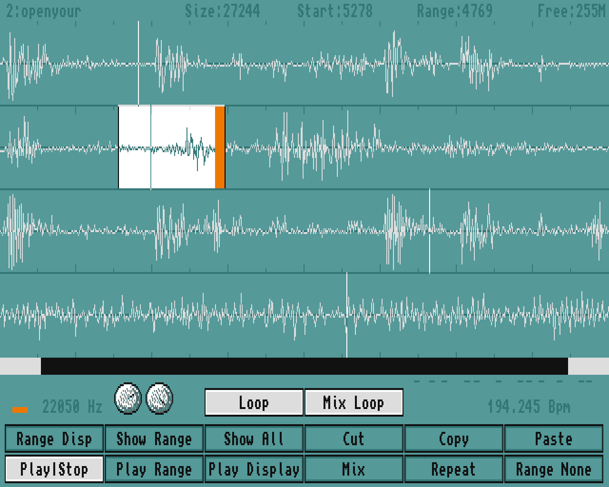
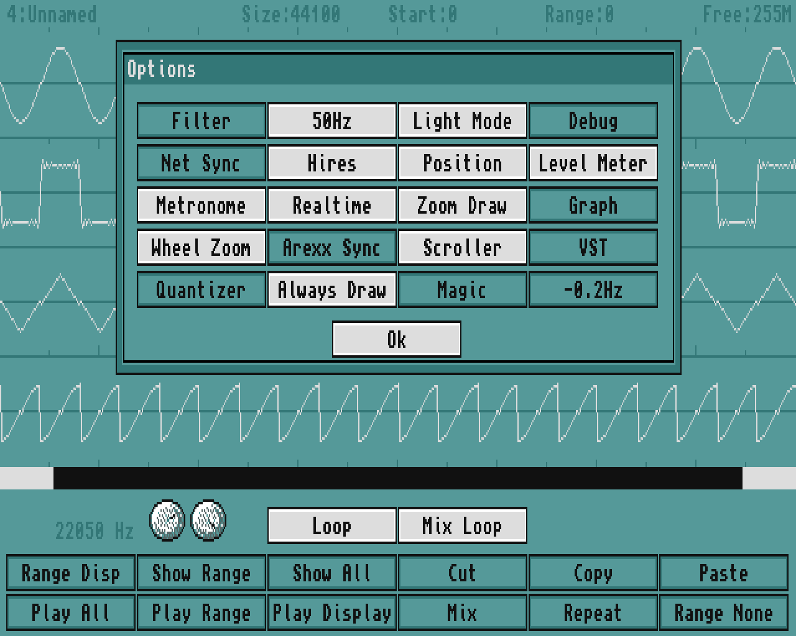
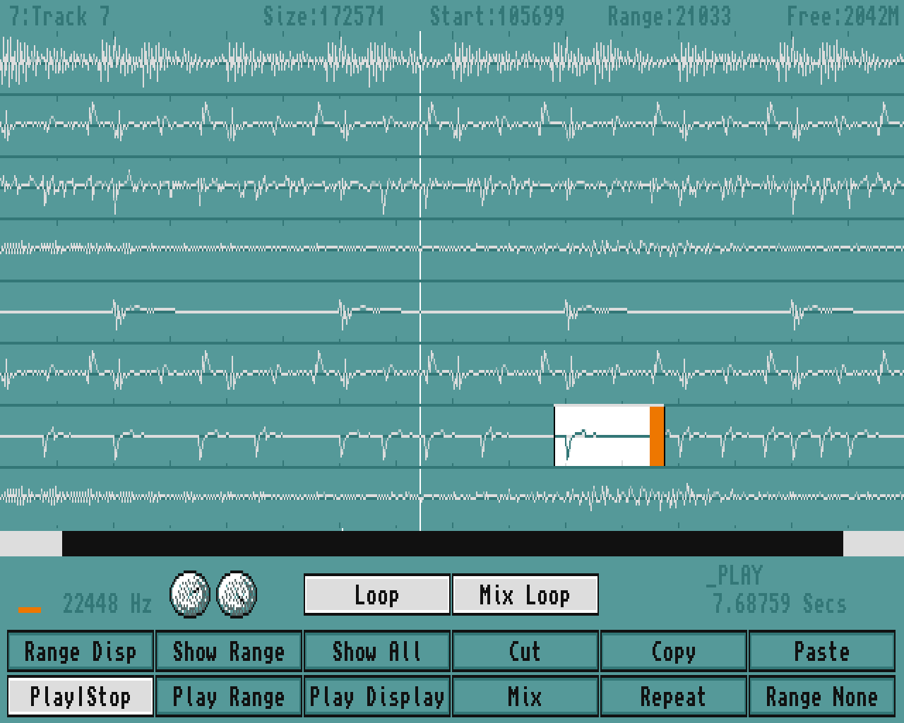
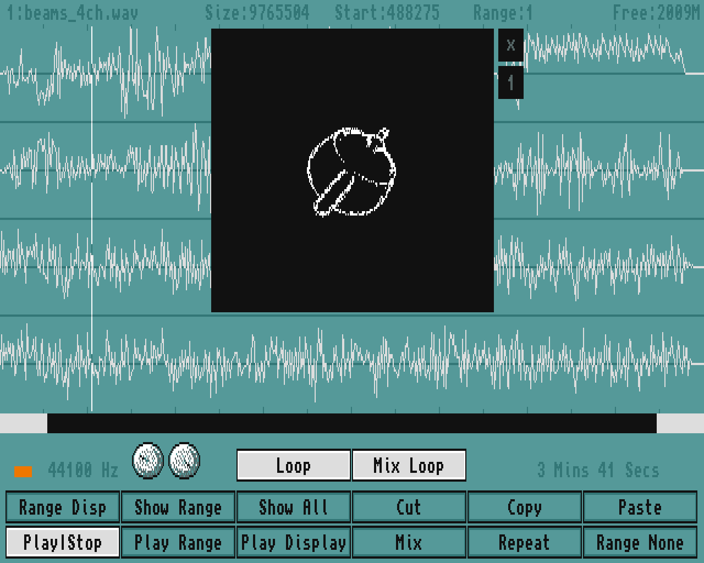

# FxBox 1.25
realtime multi loop processor editor for the Amiga range of computers m68k-amigaos >= 1.3

  8bit, 16bit and 24bit processing modes, imports Aif and Wav files,
mp2, mp3 files and Octamed modules.

  Saves Iff files, Iff CATs and AMOS sample banks.

  Can do mono, stereo, quad and 4, 8, 16 channel multi track.

  VST plugin integration with studio quality output.

  Command sequencer capable of rendering Octamed modules as waveforms.

  Network BPM sync and Octamed Arexx sync at the same time.

  Realtime processing works best on accelerated machines.

  Requires at least 1M ram, and supports up to 2G.

  Written in AMOS BASIC and compiled with .

# Source Code
there is an archive of .AMOS files and an .Asc file that is updated to compare the difference between each version

the build folder has a 'make' file that compiles FxBox using a custom APCmp command that looks for the AMOS.Library in the local folder, it builds the fxbox custom config and headers and the updated music extension. note: FxBox is fully compatible interpreted with a default installation of AMOS Professional nothing custom needs installing, the customizations are during the build process only.

    cd build
  
    execute make
